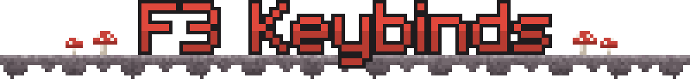
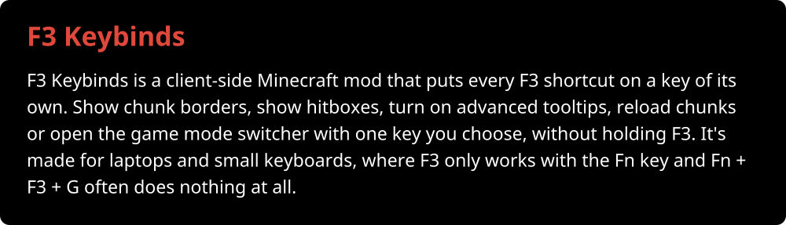
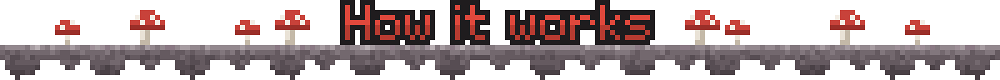
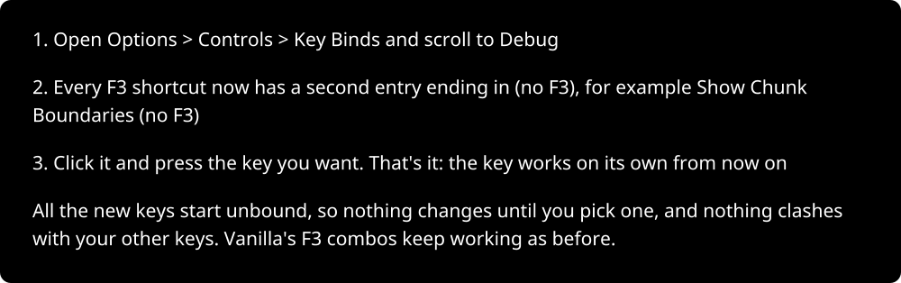
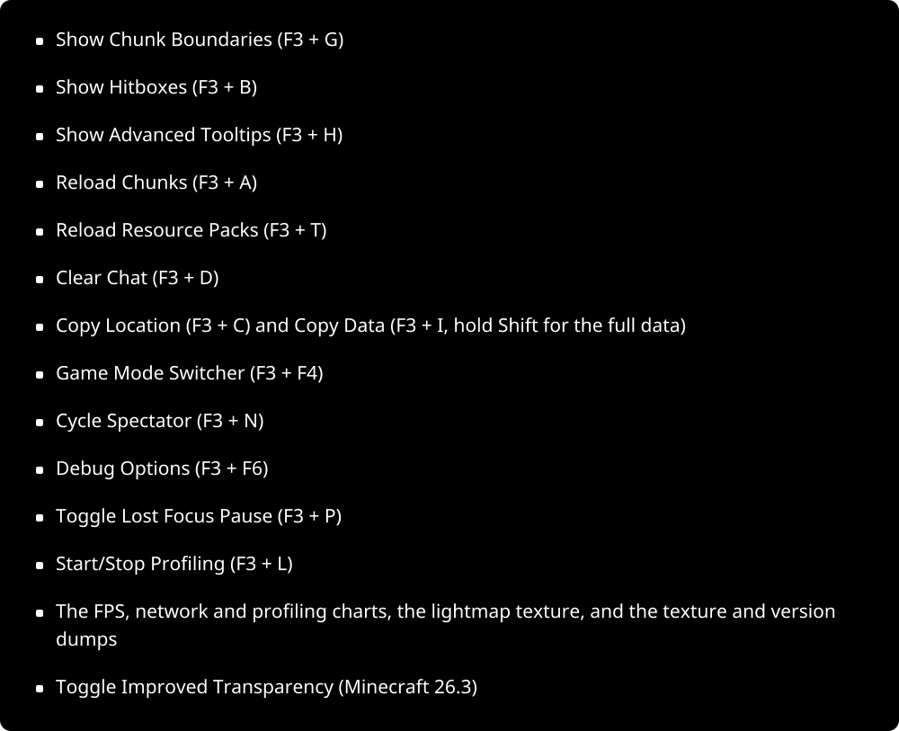
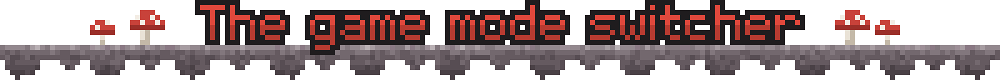
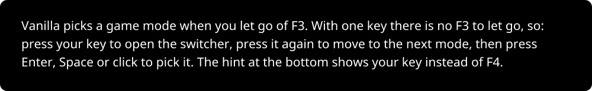
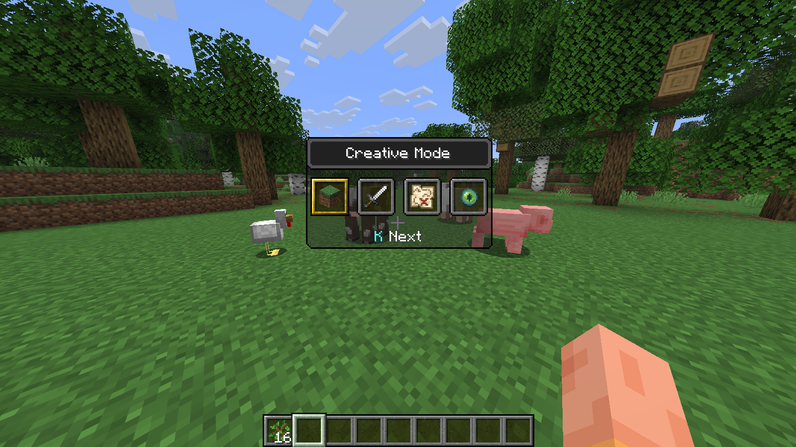
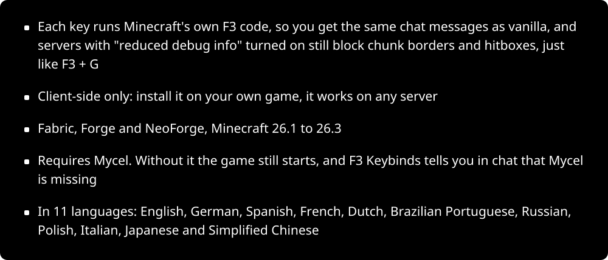

  

  
  
  
  
  
  
  
  

 Controls > Key Binds and scroll to Debug 2. Every F3 shortcut now has a second entry ending in (no F3), for example Show Chunk Boundaries (no F3) 3. Click it and press the key you want. That's it: the key works on its own from now on All the new keys start unbound, so nothing changes until you pick one, and nothing clashes with your other keys. Vanilla's F3 combos keep working as" width="100%">

