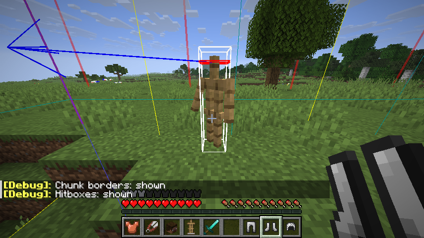

# F3 Keybinds

**F3 Keybinds** is a client-side Minecraft mod that puts every F3 shortcut on a key of its own. Show chunk borders, show hitboxes, turn on advanced tooltips, reload chunks or open the game mode switcher with one key you choose, without holding F3. It's made for laptops and small keyboards, where F3 only works with the Fn key and Fn + F3 + G often does nothing at all.

## How it works

1. Open **Options > Controls > Key Binds** and scroll to **Debug**
2. Every F3 shortcut now has a second entry ending in **(no F3)**, for example **Show Chunk Boundaries (no F3)**
3. Click it and press the key you want. That's it: the key works on its own from now on

All the new keys start unbound, so nothing changes until you pick one, and nothing clashes with your other keys. Vanilla's F3 combos keep working as before.

## Every F3 shortcut

- Show Chunk Boundaries (F3 + G)
- Show Hitboxes (F3 + B)
- Show Advanced Tooltips (F3 + H)
- Reload Chunks (F3 + A)
- Reload Resource Packs (F3 + T)
- Clear Chat (F3 + D)
- Copy Location (F3 + C) and Copy Data (F3 + I, hold Shift for the full data)
- Game Mode Switcher (F3 + F4)
- Cycle Spectator (F3 + N)
- Debug Options (F3 + F6)
- Toggle Lost Focus Pause (F3 + P)
- Start/Stop Profiling (F3 + L)
- The FPS, network and profiling charts, the lightmap texture, and the texture and version dumps
- Toggle Improved Transparency (Minecraft 26.3)

## The game mode switcher

Vanilla picks a game mode when you let go of F3. With one key there is no F3 to let go, so: press your key to open the switcher, press it again to move to the next mode, then press **Enter**, **Space** or click to pick it. The hint at the bottom shows your key instead of F4.

## Good to know

- Each key runs Minecraft's own F3 code, so you get the same chat messages as vanilla, and servers with "reduced debug info" turned on still block chunk borders and hitboxes, just like F3 + G
- Client-side only: install it on your own game, it works on any server
- Fabric, Forge and NeoForge, Minecraft 26.1 to 26.3
- Requires [Mycel](https://www.curseforge.com/minecraft/mc-mods/mycel). Without it the game still starts, and F3 Keybinds tells you in chat that Mycel is missing
- In 11 languages: English, German, Spanish, French, Dutch, Brazilian Portuguese, Russian, Polish, Italian, Japanese and Simplified Chinese
